# Wrecked Carmageddon

Wrecked Carmageddon runs Carmageddon and the Carmageddon Splat Pack on modern Windows and macOS, with new graphics, weapons and destruction. It is built on [dethrace](https://github.com/dethrace-labs/dethrace), an open-source remake of the Carmageddon engine. You need your own copy of the game; this repository has no game files.

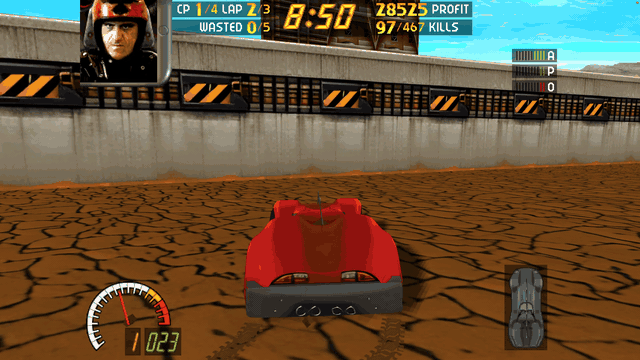

- A roof minigun (G) and a rocket launcher (F). Rockets leave craters and blow holes in walls.
- See-through water with waves, reflections and splashes. Cars float, then sink.
- Light from fires, explosions, sparks and police cars, and headlights (N).
- Soft smoke and new flames on burning cars.
- Rounded car bodies and wheels, shiny paint and sun shadows.
- Full-resolution widescreen graphics, with smoothly upscaled menus and HUD.
- Every texture AI-upscaled 4x (skies 8x).

## In action

<table>
<tr><td>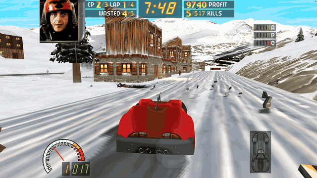 A rocket through a ski chalet</td><td>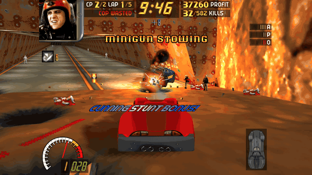 A crater in the tunnel floor throws a monster truck</td></tr>
<tr><td>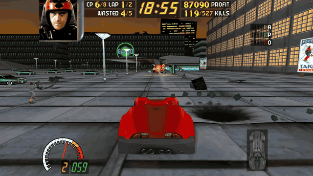 Props break into pieces</td><td>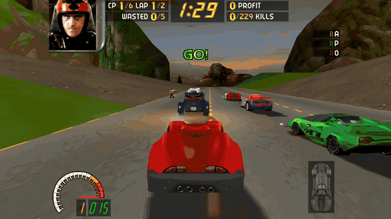 Homing rockets on the starting grid</td></tr>
<tr><td>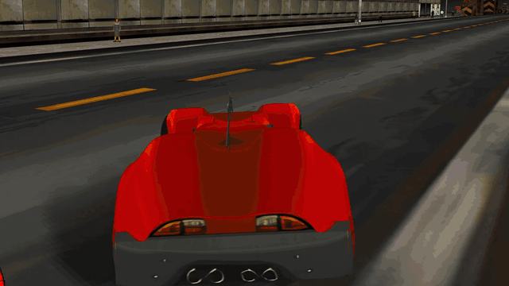 The roof minigun rises and fires</td><td>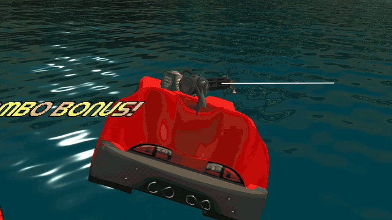 See-through water with waves, reflections and splashes</td></tr>
<tr><td>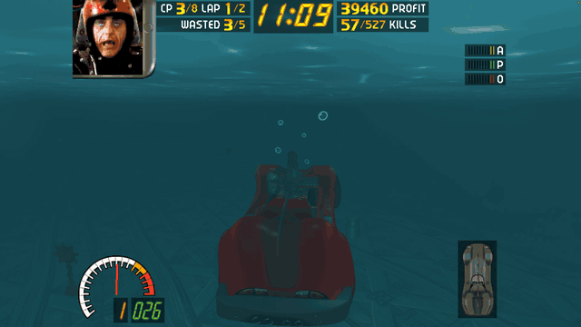 A murky, wobbling view under water</td><td>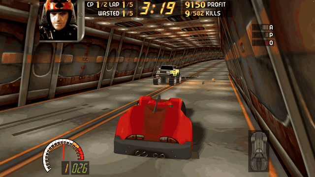 Light from fires and explosions</td></tr>
<tr><td>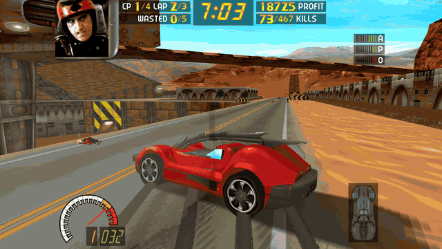 Rounded car bodies and shiny paint</td><td>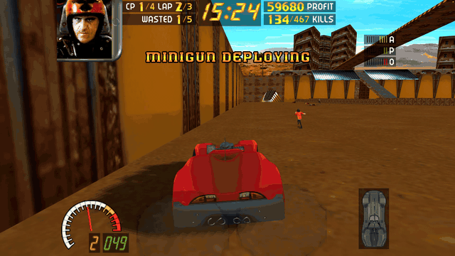 Sun shadows</td></tr>
<tr><td>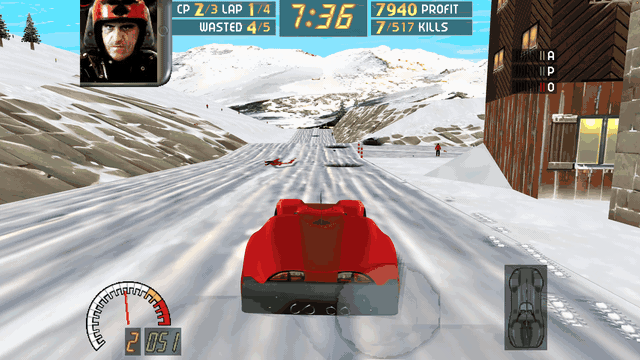 Full-resolution widescreen with AI-upscaled textures</td></tr>
</table>

Gameplay videos with the mod, no commentary: [city](https://youtu.be/NMI3kjMPtiE), [countryside](https://youtu.be/j5IL_x2jJIw), [snow](https://youtu.be/f8QFr3FzumY), [desert](https://youtu.be/V5kI3wSsw0E), [underground](https://youtu.be/03czFuH0KXU).

Website: [breakvanilla.com](https://breakvanilla.com/). Videos: [youtube.com/@BreakVanilla](https://www.youtube.com/@BreakVanilla).

## Install

Download the zip for your system from Releases and follow its `README.txt` ([`tools/mod/README.txt`](tools/mod/README.txt)): everything goes into the game folder, next to `DATA`. Tested with the Steam Max Pack and the DOS release.

## Repository

| Path                               | What it is                                                  |
| ---------------------------------- | ----------------------------------------------------------- |
| `patches/dethrace-game.patch`      | game changes: weapons, destruction, water, fixes            |
| `patches/dethrace-harness.patch`   | platform layer: resolution, settings, mod folder, test mode |
| `patches/brender-glrend.patch`     | OpenGL renderer: lights, textures, curved cars, water       |
| `vendor/stb_image.h`               | PNG loader for the HD textures                              |
| `vendor/LGPL-2.1.txt`              | libsmacker's licence, shipped in the packages               |
| `tools/make_mod.sh`                | builds the Windows and Mac packages                         |
| `tools/mingw-w64-x86_64.cmake`     | CMake toolchain for the Windows cross build                 |
| `tools/mod/`                       | the package's `dethrace.ini` and player README              |
| `tools/add_minigun_sound.py`       | makes the mod's sounds                                      |
| `tools/make_minigun_textures.py`   | paints the mod's own textures                               |
| `tools/soft_effects.py`            | new flames and soft-edged smoke                             |
| `tools/hires_textures.py`          | AI-upscales the game's textures with Upscayl                |
| `tools/decrypt_txt.py`             | decodes encrypted game text; used by hires_textures.py      |
| `tools/set_keys.py`                | arrow-key driving for the local build                       |
| `tools/test_game.sh`               | runs the game hidden from a test script                     |
| `tools/contact_sheet.py`           | tiles test screenshots into one image                       |
| `tests/`                           | test scripts                                                |
| `docs/`                            | GIFs for this README                                        |
| `setup.sh`, `setup-native.sh`      | set up the local build                                      |
| `native.command`                   | starts the local build                                      |

The patches apply to dethrace `166dd93`: the two dethrace patches in its folder, `brender-glrend.patch` in `lib/BRender-v1.3.2`. `stb_image.h` goes in `lib/BRender-v1.3.2/drivers/glrend`.

## Build the packages

`tools/make_mod.sh` builds both zips into `local/dist/`, from a fresh dethrace checkout in `local/mod-build/`. It needs `brew install cmake mingw-w64`, the local build below, and the HD textures: run `.venv/bin/python tools/hires_textures.py` on `local/native/CARMA/DATA` and `local/native/CARSPLAT/DATA` first.

The mod's files go in a `wrecked-carmageddon` folder next to the game's `DATA`, and the patched engine finds them itself, so no game file is edited:

- `dethrace.ini`: read after the player's own; its `[Environment]` section sets the `CARMA_*` settings.
- `HIRES/`: HD textures, looked up after `DATA/HIRES`.
- `SOUND/SOUND.TXT`: the mod's sounds, loaded after the game's.
- `dethrace.log`: the program's output when it is started from Explorer or the Finder.

The engine also finds the game folder from the program's own location (on macOS even under App Translocation), shows startup errors in a window, and reads the DOS release's `RACES/VOODOO.TXT`, which uses the game's other encryption method.

Developer tools (the test mode, `CARMA_RACE`, `CARMA_TEST_SILENT` and the T music key) are behind the CMake option `CARMA_DEV`: on in the local build, off in the packages.

## Features in detail

`CARMA_*` settings are environment variables. In the packages, set them in the `[Environment]` section of `wrecked-carmageddon/dethrace.ini`; in the local build, before the command, for example `CARMA_REFLECTIONS=0.6 ./native.command carma`.

- **Resolution:** the 3D scene renders at the screen's full pixel resolution, with 4x antialiasing.
- **HUD and menus:** the 640x480 art is scaled up with sharp square pixels and smoothed edges. `CARMA_HUD_FILTER=xbr` redraws edges as curves; `nearest` gives plain pixels.
- **Lights:** fires, explosions, sparks, rockets, the Electro-Bastard Ray and police cars light up what is around them. N switches headlights. `CARMA_LIGHTS` sets the strength (0 is off); `CARMA_HEADLIGHTS=on` or `auto` (dark tracks only) starts with headlights on.
- **HD textures:** `<texture>.png` in `DATA/HIRES` or `wrecked-carmageddon/HIRES` replaces the 8-bit texture. `tools/hires_textures.py` makes them with [Upscayl](https://upscayl.org).
- **Curved cars:** car bodies and wheels are tessellated into curved surfaces (PN triangles, OpenGL 4.0); crash damage still works. `CARMA_TESSELLATION` sets the level (default 6, 0 is the original).
- **Reflections:** car paint reflects the sky, with a sun glint. `CARMA_REFLECTIONS` sets the strength (default 0.35).
- **Widescreen:** races fill a wide screen with a wider view; HUD, menus and cockpit stay 4:3. `CARMA_WIDESCREEN=0` turns it off.
- **Sun shadows:** objects within about 70 m cast shadows on the track, replacing the flat car shadows. `CARMA_SHADOWS=0` turns them off.
- **Smoke and fire:** smoke, fireballs, scorch marks and bullet holes have soft edges, and burning cars have new flames (`tools/soft_effects.py`).
- **Frame rate:** follows the display, capped at 120, with physics every frame instead of 25 times a second (experimental in dethrace).

**Water** (`water.c`):

- Waves, a sun glint and reflections; see-through shallows with light ripples on the bottom; foam at the shore and on splashes.
- Cars float and can paddle to shore. They sink in about 3 seconds (1.5 once wrecked), then go back on the track. Props float too.
- Splashes, ripples, wakes and bubbles, and a murky, wobbling view under water.
- `CARMA_WATER=0` gives the original water.

**Minigun** (`minigun.c`):

- G raises an M134-style gun through a roof hatch in about 2 seconds; G again stows it, also halfway through.
- It fires at the nearest visible pedestrian, opponent or police car within about 60 m. Pedestrians fall after three hits; cars take damage and get pushed.
- The barrels spin up before firing and overheat after 5 seconds of continuous fire.
- Off in network games and action replay.

**Rocket launcher** (`rocket.c`):

- Two pods on the front bumper, two tubes each. F fires a rocket; hold F for one every 0.25 s. Each tube reloads in 2.5 s.
- Rockets accelerate to about 350 km/h, steer towards a target within 15 degrees, and explode on contact or after 3 seconds.
- The blast hits everything within about 6 m: cars are damaged, dented and thrown (a direct hit takes about a third of a car's health), pedestrians die and props fall. Your own car takes a third of the damage.
- Off in network games; not recorded in action replay.

**Destruction** (`destruct.c`, `deform.c`, `shatter.c`):

- Bullets throw sparks, dust and chips and leave holes (the last 200 stay). Five hits knock a prop over.
- Hard crashes throw chunks of wall and dust.
- Rockets dent the track up to about 75 cm deep and 3 m across, and cars drive through the craters. `CARMA_CRATERS` scales the depth (0 is off).
- Rockets blow holes about 4 m across in walls; the chunks fly out and lie as rubble for up to 30 seconds.
- Props within about 4.5 m of a blast break into pieces.

**Fixes to dethrace** (`dethrace-game.patch`):

- The Electro-Bastard Ray's lightning is drawn in OpenGL mode.
- Sparks and lightning are one 640x480 pixel wide at any resolution, as in the software renderer.
- The depth buffer is cleared even when the last thing drawn had depth writes off.
- Pedestrians and power-ups appear out to the draw distance, not 11 units, and distant pedestrians move.
- Action replay drops objects beyond 255 per frame instead of stopping the game.

## Local build

The local build is for working on the mod on a Mac. It uses a DOS install of the Max Pack that keeps some data on its CD images: a `Carmaged` folder with `CARMA`, `CARSPLAT` and the CD images in `cd`.

1. `brew install sdl2 cmake vorbis-tools bchunk`
2. Zip that folder to `local/carmageddon.zip` (or set `GAME_ZIP`) and run `./setup.sh`, which unpacks it into `local/carmaged/`. Once step 3 has built `local/native/`, `local/carmaged/` can be deleted.
3. Run `./setup-native.sh`. It builds dethrace in `local/ports/dethrace` with `CARMA_DEV` on, and builds `local/native/CARMA` and `local/native/CARSPLAT` with the CD data, the music as `MUSIC/TrackNN.ogg`, and the mod's sounds and textures. It makes the HD skies if Upscayl is installed, and creates `local/Carmageddon.app` and `local/Carmageddon Splat Pack.app`.
4. Run `./native.command`, or `./native.command carma` or `splat`. Further arguments go to dethrace, for example `--window`.

`native.command` unlocks every race, car and upgrade; `CARMA_UNLOCK_ALL=0` plays from rank 99. If the repository is in `~/Downloads`, `~/Documents` or `~/Desktop`, the two apps need Full Disk Access.

In the local game folders `tools/set_keys.py` moves driving to the arrow keys. The packages keep the game's keys and add only G, F and N.

| Key           | Action                          |
| ------------- | ------------------------------- |
| Up / Down     | accelerate / brake and reverse  |
| Left / Right  | steer                           |
| Space         | handbrake                       |
| `[` / `]`     | camera zoom in / out, map pan   |
| `;` / `'`     | camera rotate, map pan          |
| G             | minigun deploy / stow           |
| F             | fire a rocket (hold for salvo)  |
| N             | headlights on / off             |
| T             | music on / off                  |
| Y             | recover the car                 |

## Automated testing

`tools/test_game.sh SCRIPT [carma|splat]` runs the local build from a test script, in a hidden window with no sound, without taking focus or reading the keyboard. Screenshots and `run.log` go to `/tmp/carma_test/<script name>/`. `tools/contact_sheet.py OUT.png IMAGE...` tiles the screenshots.

- `CARMA_TEST_WINDOW=WxH`: window size (default 640x480).
- `CARMA_RACE=NAME`: start on the first race whose name contains NAME.
- `CARMA_TEST_SILENT=1`: run the sound code without a sound device.
- `CARMA_TEST_TIMEOUT`: seconds before the game quits (default 600).

The scripts are in `tests/`; each starts with a comment saying what it tests. Commands, one per line, `#` for comments:

| Command                 | What it does                                                  |
| ----------------------- | ------------------------------------------------------------- |
| `wait MS`               | pause                                                         |
| `press KEY [COUNT]`     | tap a key (SDL key names such as `Return`, `Up`, `G`)         |
| `hold KEY MS`           | hold a key down                                               |
| `down KEY` / `up KEY`   | press or release a key and carry on                           |
| `wait_racing [MS]`      | wait until a race is running and the countdown is over        |
| `screenshot NAME`       | save the next frame as `NAME.png`                             |
| `state`                 | print race, car and weapon state                              |
| `log TEXT`              | print a line                                                  |
| `blast_prop`            | rocket explosion at the nearest street furniture              |
| `blast_car`             | rocket explosion at the player's car                          |
| `ignite_car`            | set the player's car on fire for 20 seconds                   |
| `goto_water`            | drop the player's car into the nearest water                  |
| `dive_water`            | put the player's car under the nearest water                  |
| `quit`                  | exit                                                          |

## Licence

Wrecked Carmageddon is a modified dethrace, so it is under the GNU General Public License version 3 ([`LICENSE`](LICENSE)). The packages also use BRender (MIT), SDL2 (zlib), miniaudio, inih (BSD), libsmacker (LGPL 2.1) and stb_image; their licences are in `wrecked-carmageddon/LICENSES`.

Neither this repository nor the packages contain files from the original game; the HD textures are AI upscales of the game's own. Carmageddon belongs to its owners.
